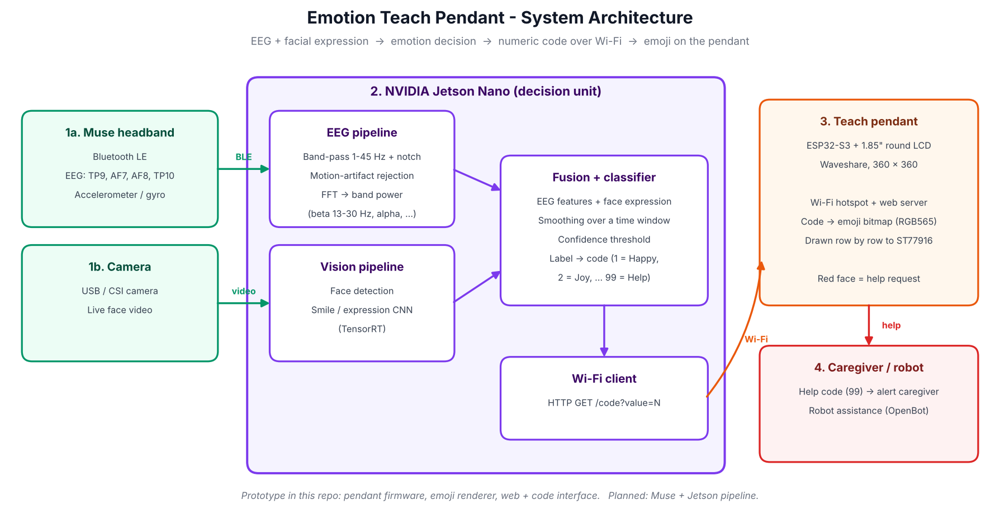
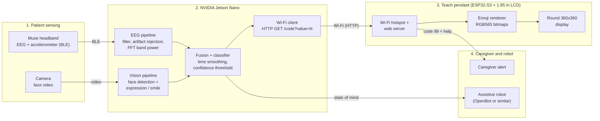
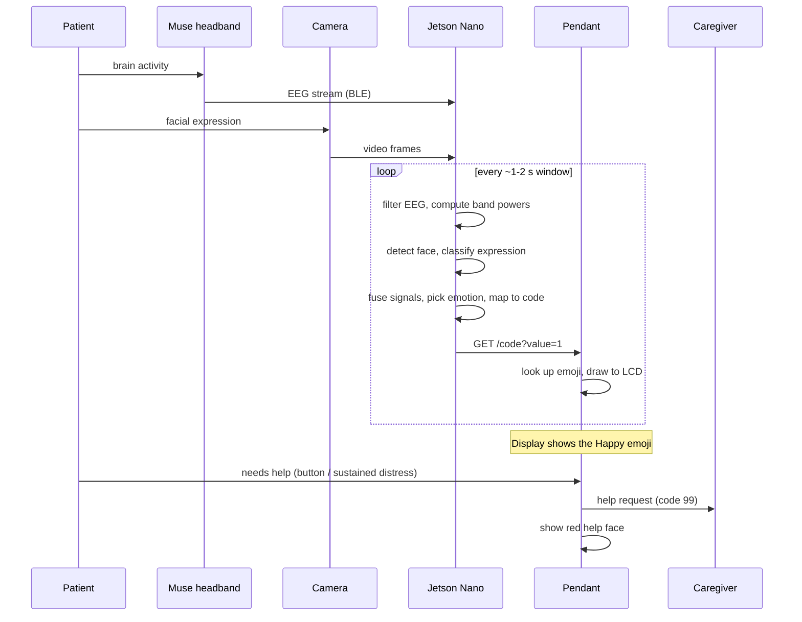
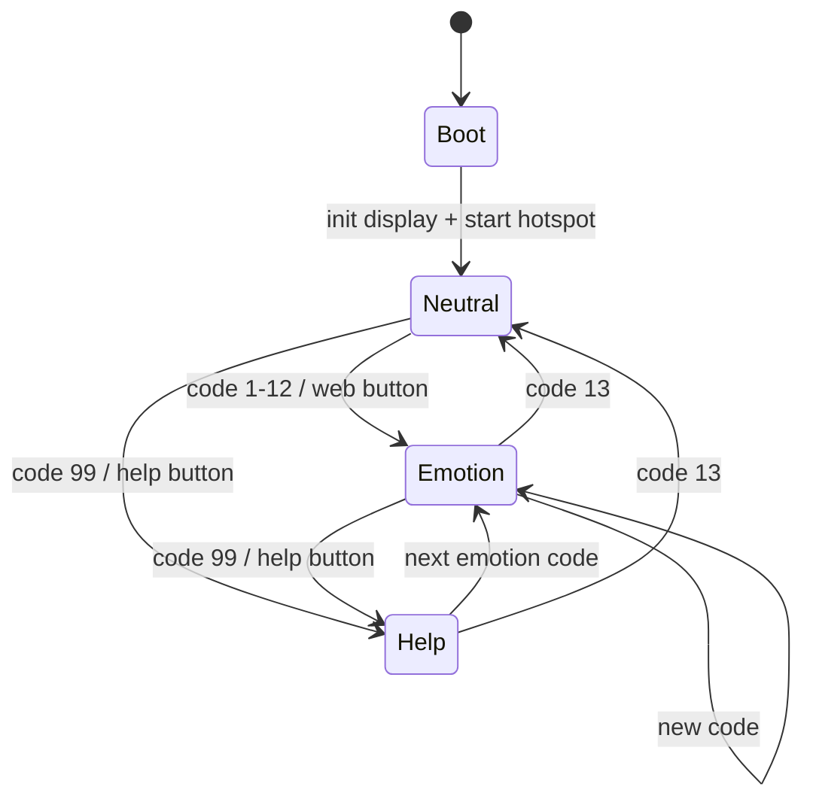
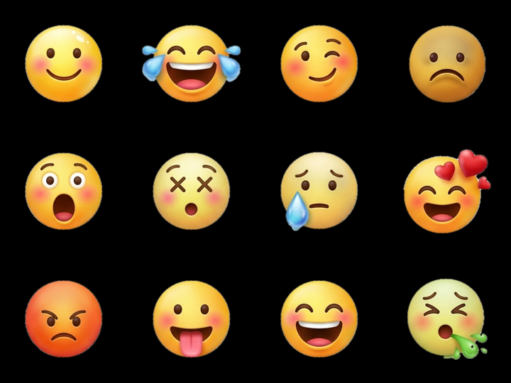
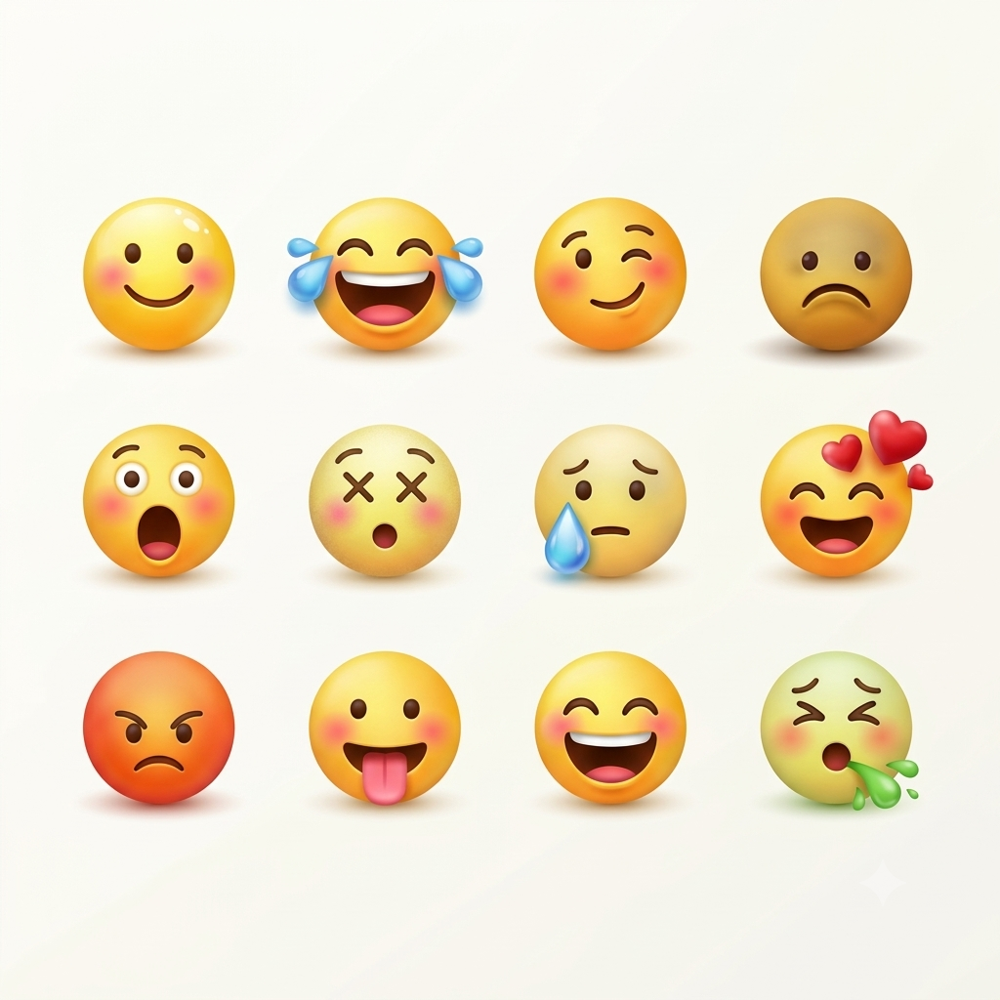

# Emotion Teach Pendant

A handheld **teach pendant for an assistive care-giving robot**. It shows the wearer's emotional state as an emoji on a round display, so people around a patient with limited communication ability can see how they are feeling, and the patient can ask for caregiver help.

> **Idea in one sentence:** a Muse EEG headband and a camera feed a Jetson Nano, which decides the patient's emotion and sends a small numeric code (`1` = Happy, `2` = Joy, ...) over Wi-Fi to the pendant, which shows the matching emoji.



---

## Contents

1. [Background and assignment](#background-and-assignment)
2. [Project status](#project-status)
3. [System architecture](#system-architecture)
4. [Emotion codes](#emotion-codes)
5. [Signal processing and decision logic](#signal-processing-and-decision-logic)
6. [Pendant firmware](#pendant-firmware)
7. [Hardware and cost](#hardware-and-cost)
8. [Repository layout](#repository-layout)
9. [Build and flash](#build-and-flash)
10. [Using the pendant](#using-the-pendant)
11. [Regenerating the emojis](#regenerating-the-emojis)
12. [Known issues and lessons learned](#known-issues-and-lessons-learned)
13. [Future work](#future-work)
14. [Credits and licenses](#credits-and-licenses)

---

## Background and assignment

A teach pendant is a handheld device used to control and program robots. This project is a system design of a pendant for a robot that helps with **caregiving for a person with limited communication capabilities**, and can **request external assistance from caregivers** when necessary.

Design requirements:

- The robot monitors the patient's brainwaves (beta waves, 13-30 Hz, among others) to infer a state of mind such as happy, sad, angry or indifferent.
- The pendant **externally displays** the wearer's emotion as an **emoji or a word**.
- The pendant can **request caregiver help**.
- Hardware and software together (including an OpenBot-type mechanical base) cost **under $1000**.
- Intended building blocks: Muse headset (raw EEG, FFT, accelerometer), Jetson Nano / Xavier NX, an OLED or phone-style display, and open-source libraries. Facial-expression recognition can be used to correlate with the brain signals.

This repository contains the working pendant (display + firmware) and the design of the full sensing and decision pipeline.

---

## Project status

| Component | Status |
|---|---|
| Pendant firmware (Wi-Fi hotspot, web UI, emoji display) | Working |
| 12 emoji bitmaps converted for the 360x360 round LCD | Working |
| Numeric code protocol (`/code?value=N`) | Implemented in firmware |
| Caregiver help request (red face on pendant) | Working |
| Test client to send codes from a laptop / Jetson | Included (`jetson/send_code.py`) |
| Muse EEG acquisition and filtering | Designed (not in this repo yet) |
| Face / smile recognition on the Jetson Nano | Designed (not in this repo yet) |
| EEG + face fusion and emotion classifier | Designed (not in this repo yet) |
| Forwarding help requests to a caregiver (SMS / app) | Designed (not in this repo yet) |

In this prototype the emotion is chosen **by hand from a web page** served by the pendant (or by sending a code with the test script). In the full system the Jetson Nano makes that decision automatically.

---

## System architecture



### Data flow



### Pendant behaviour



---

## Emotion codes

The Jetson sends a number; the pendant looks it up in a table (`EMOTIONS[]` in the firmware) and draws the matching bitmap.

| Code | Emotion | Display |
|---:|---|---|
| 1 | Happy | emoji bitmap |
| 2 | Joy | emoji bitmap |
| 3 | Wink | emoji bitmap |
| 4 | Sad | emoji bitmap |
| 5 | Surprised | emoji bitmap |
| 6 | Dizzy | emoji bitmap |
| 7 | Worried | emoji bitmap |
| 8 | Love | emoji bitmap |
| 9 | Angry | emoji bitmap |
| 10 | Silly | emoji bitmap |
| 11 | Excited | emoji bitmap |
| 12 | Sick | emoji bitmap |
| 13 | Neutral | drawn procedurally |
| 99 | **Help request** | red face drawn procedurally |



The source artwork the bitmaps were cut from:



To add or reorder emotions, edit the `EMOTIONS[]` table in `EmotionPendant.ino`. The code is simply the table position plus one.

---

## Signal processing and decision logic

This section describes the planned Jetson-side pipeline.

### 1. EEG acquisition (Muse)

- Muse headbands stream 4 EEG channels (TP9, AF7, AF8, TP10) at 256 Hz over Bluetooth LE, plus accelerometer and gyroscope data.
- Typical open-source options for reading the stream: BrainFlow, `muselsl` / LSL.

### 2. Filtering

- Band-pass roughly 1-45 Hz, plus a notch at mains frequency (50/60 Hz).
- Reject noisy windows using the **accelerometer** (head motion) and amplitude thresholds. Jaw clenching and blinks are the biggest sources of artifacts on a forehead headband.

### 3. Feature extraction

- Compute band power per channel in windows of about 1-2 s using FFT / Welch:

| Band | Range | Typical association |
|---|---|---|
| Delta | 1-4 Hz | deep sleep |
| Theta | 4-8 Hz | drowsiness, meditation |
| Alpha | 8-13 Hz | relaxed wakefulness |
| **Beta** | **13-30 Hz** | alertness, active thinking, stress / tension |
| Gamma | 30-45 Hz | high-level processing (noisy on dry electrodes) |

- Useful features: relative band powers, beta/alpha ratio, and **frontal alpha asymmetry** between AF7 and AF8, a commonly used indicator of emotional valence.

These associations are heuristics and vary a lot between people, so the classifier needs per-user calibration.

### 4. Face recognition and correlation

- Detect the face and classify the expression (smile / neutral / frown, or a fuller emotion set) with a CNN accelerated on the Jetson (TensorRT / `jetson-inference` / DeepStream, OpenCV).
- **Calibration phase:** while the patient wears the headband, the facial expression provides labels for each EEG window, so the camera trains the EEG classifier (the correlation suggested in the assignment hint).
- **Runtime:** when the face is visible, combine both signals. When the face is hidden or the patient has limited facial expression, fall back to EEG only.

### 5. Fusion and decision

- Classify each window (for example an SVM, random forest or a small neural network on the combined features).
- Smooth over several windows and require a confidence threshold, so the display does not flicker between emotions.
- Convert the label to a code and send it to the pendant.
- Sustained distress (for example repeated Angry/Sad with high beta) or a button press produces **code 99** to ask for help.

---

## Pendant firmware

Firmware for a **Waveshare ESP32-S3-Touch-LCD-1.85** (360x360 round ST77916 display).

- Starts a Wi-Fi access point **`Emotion_Pendant`** (password `12345678`; change it before real use) at `192.168.4.1`.
- Serves a phone-friendly web page with one button per emotion plus a help button.
- Exposes an HTTP interface:

| Endpoint | Purpose |
|---|---|
| `GET /` | web page with emotion buttons |
| `GET /emotion?value=Happy` | show an emotion by name |
| `GET /code?value=1` | show an emotion by numeric code (used by the Jetson) |
| `GET /help` or `GET /code?value=99` | show the help face / register a help request |

- Emoji are stored in flash as RGB565 bitmaps (`emoji_data.h`, about 2.2 MB) and drawn row by row.
- `Neutral` and the red help face are drawn procedurally.

---

## Hardware and cost

Approximate prices, which change often, so check current listings.

| Item | Role | Approx. cost (USD) |
|---|---|---:|
| Muse headband (Muse 2 / Muse S) | EEG + motion sensing | 250 - 400 |
| NVIDIA Jetson Nano (or similar) | Filtering, vision, fusion, decision | 100 - 250 |
| USB / CSI camera | Face recognition | 20 - 40 |
| Wi-Fi adapter for the Jetson (if not built in) | Link to pendant | 10 - 20 |
| Waveshare ESP32-S3 1.85" round LCD | The pendant (display + Wi-Fi) | 25 - 40 |
| OpenBot (or similar) robot base | Mechanical assistive robot | 50 - 150 |
| Power bank, cables, enclosure | Misc. | 30 - 60 |
| **Estimated total** | | **roughly 500 - 950** |

This is within the $1000 target; the Muse headband and Jetson are the main cost drivers.

> **Note on component choice:** the assignment lists an OLED or phone screen as the display. This project uses a self-contained ESP32-S3 round LCD module instead, which handles the Wi-Fi link and display in one unit.

---

## Repository layout

```
emotion-teach-pendant/
├── README.md
├── LICENSE
├── .gitignore
├── firmware/
│   └── EmotionPendant/          Arduino sketch (open this folder in the Arduino IDE)
│       ├── EmotionPendant.ino   main program: Wi-Fi, web server, emoji drawing
│       ├── emoji_data.h         generated emoji bitmaps (RGB565)
│       ├── partitions.csv       6 MB app partition (emoji data is large)
│       └── *.cpp / *.h / *.c    Waveshare display, I2C, IO-expander drivers
├── tools/
│   └── convert_emojis.py        emoji sheet -> emoji_data.h
├── jetson/
│   └── send_code.py             send emotion codes to the pendant (test / integration)
└── docs/
    └── images/                  architecture diagram, emoji preview, source art
```

---

## Build and flash

**Requirements:** Arduino IDE with the ESP32 board package (ESP32-S3 support).

1. Open `firmware/EmotionPendant/EmotionPendant.ino`.
2. Select the board settings recommended on the [Waveshare ESP32-S3-Touch-LCD-1.85 wiki](https://www.waveshare.com/wiki/ESP32-S3-Touch-LCD-1.85) (ESP32S3 Dev Module).
3. Set **Flash Size = 16MB**.
4. The sketch is about 3.1 MB because of the emoji data, which does not fit the default 1.3 MB app partition. Either:
   - choose a **Partition Scheme** of *Huge APP (3MB No OTA / 1MB SPIFFS)*, or
   - keep `partitions.csv` next to the `.ino` (a 6 MB app partition) and restart the IDE so it is picked up.
5. Upload.

If the sketch is still too large, regenerate the emojis smaller: `python3 tools/convert_emojis.py docs/images/emoji_sheet.png --size 240`.

---

## Using the pendant

1. Power the pendant. It shows the Neutral face.
2. On a phone or laptop, join Wi-Fi **Emotion_Pendant**.
3. Open **http://192.168.4.1** and tap an emotion, or the red help button.

### Sending codes like the Jetson will

```bash
python3 jetson/send_code.py 1      # Happy
python3 jetson/send_code.py 4      # Sad
python3 jetson/send_code.py 99     # help request
python3 jetson/send_code.py --demo # cycle through all emotions
```

The machine running the script must be connected to the `Emotion_Pendant` network.

---

## Regenerating the emojis

`tools/convert_emojis.py` cuts the emojis out of a 4x3 emoji sheet, removes the background and shadows, scales them to fit the round display, and writes RGB565 data.

```bash
pip install pillow numpy scipy
python3 tools/convert_emojis.py docs/images/emoji_sheet.png            # default 300x300
python3 tools/convert_emojis.py docs/images/emoji_sheet.png --size 240 # smaller flash use
python3 tools/convert_emojis.py docs/images/emoji_sheet.png --swap     # if colours look wrong
```

It writes `emoji_data.h` (copy it into `firmware/EmotionPendant/`) and `preview.png`.

---

## Known issues and lessons learned

- **Right half of the emoji cut off / streaks:** the display driver starts each row transfer in the background and returns immediately. Re-using one row buffer let the next row overwrite data still being sent. The fix is two alternating row buffers plus a short delay per row (see `drawEmoji()`).
- **Happy and sad were swapped in the first prototype:** screen y grows downward, so a curve with the middle *higher* than the ends is a frown. Fixed in `renderFace()`.
- **Flash size:** 12 emojis at 300x300 in RGB565 is about 2.2 MB, which needs a larger partition (see [Build and flash](#build-and-flash)).
- **Redraw time:** a full redraw takes a few hundred milliseconds, fine for emotion changes but not for animation.

---

## Future work

- Implement and evaluate the Jetson pipeline (Muse acquisition, filtering, face model, fusion).
- Per-patient calibration routine and accuracy evaluation.
- Caregiver notifications (SMS / push message) when a help request arrives.
- Pendant button / touch input for the patient to request help directly (the board has a touch controller).
- Optional word label under the emoji, and animated transitions.
- Authentication on the pendant's HTTP endpoints.

---

## Credits and licenses

- Display, I2C and IO-expander driver code is adapted from the Waveshare ESP32-S3-Touch-LCD-1.85 demo and remains subject to Waveshare's license terms.
- Muse is a product of Interaxon. This project is not affiliated with or endorsed by Interaxon, NVIDIA or Waveshare.
- The emoji artwork was AI-generated; check the terms of the tool you used before any commercial use.
- Original code in this repository is released under the [MIT License](LICENSE).
